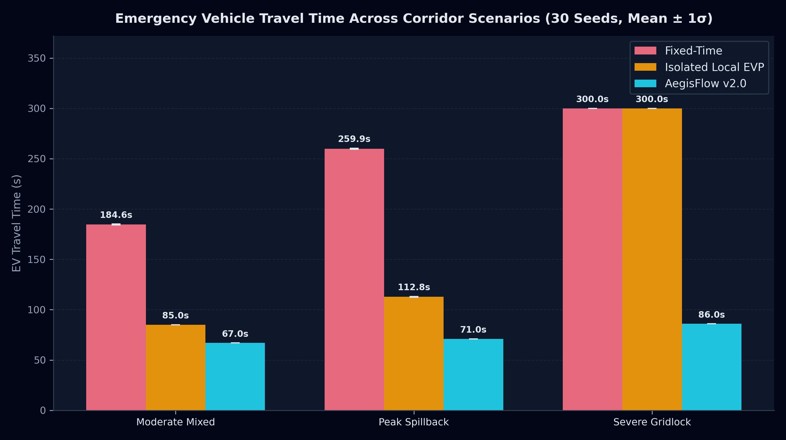
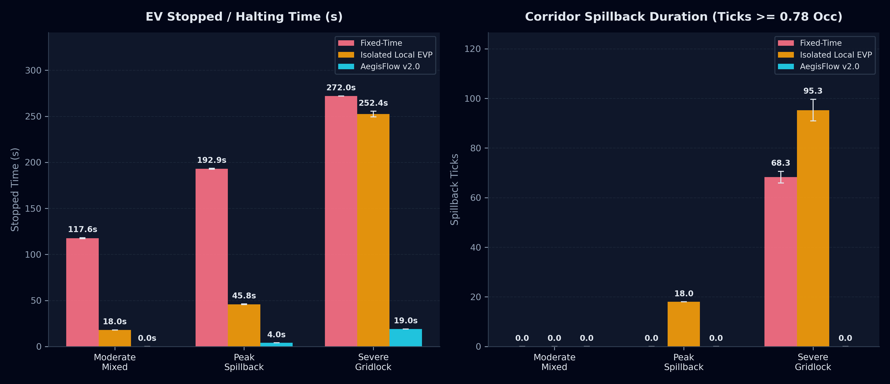
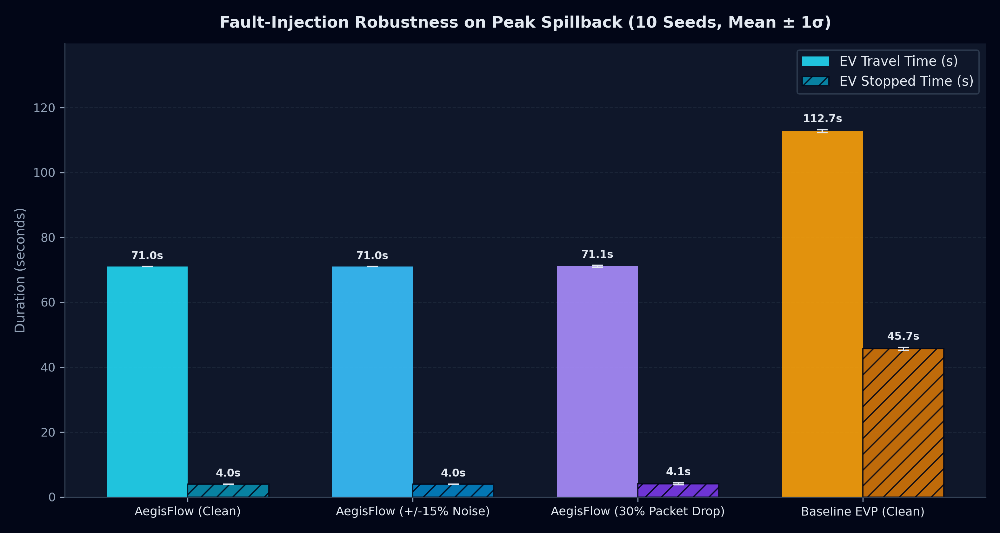

# AegisFlow v2.0

**Predictive Emergency Corridor Orchestration with Inter-Junction Traffic Intelligence**

AegisFlow shifts urban emergency vehicle priority (EVP) from blind, single-junction reactive preemption to **corridor-wide, physics-informed queue orchestration** gated by a **deterministic municipal Safety Shield**.

---

## Core Paradigm Shift: Reactive Preemption vs. Predictive Orchestration

| Dimension | Legacy Isolated Local EVP | AegisFlow v2.0 (Predictive Corridor) |
|---|---|---|
| **Trigger Horizon** | Blind local detection only within `<= 110 m` of one signal (`IsolatedEVPController`) | Multi-junction upstream alert cascade (`30–60 s` / default `45 s` lookahead) |
| **Downstream Awareness** | None — flushes upstream junction `J_A` blindly into standing queues at `J_B` | Inter-junction telemetry shared across `J_A -> J_B -> J_C` via `JunctionStatePacket` |
| **Queue & Congestion Modeling** | Vehicle count / fixed `30s` cycle blind to heterogeneous mixed traffic | BEV ground-plane spatial occupancy (`m²/m²`) & Indian PCU density weighting |
| **Congestion Strategy** | Traps EV inside downstream spillback at `J_B` during peak loads | Proactive `RED_TRUNCATION` flush ahead of EV + `UPSTREAM_METERING` backpressure |
| **Safety Verification** | Fixed hard-coded timers | Simplex Safety Shield enforcing 5 strict invariants (`0` unsafe transitions) |

---

## 5-Layer System Architecture

```text
+------------------------------------------------------------------------------+
| LAYER 1: EDGE PERCEPTION (perception/) & DIGITAL TWIN (sim/, orchestrator/)  |
|  - CCTV Camera -> YOLOv11n + ByteTrack -> 4-Pt Homography BEV (7m x 50m)     |
|  - Heterogeneous Indian Mix (2W / Auto / Car / Bus / Truck / Ambulance)      |
|  - Emits identical Pydantic v2 JunctionStatePacket (~1.2 KB JSON @ 1 Hz)     |
+--------------------------------------+---------------------------------------+
                                       |  HTTP POST /api/v1/junctions/{id}/state
                                       v
+------------------------------------------------------------------------------+
| LAYER 2: INTER-JUNCTION API GATEWAY & STATE HUB (backend/)                   |
|  - FastAPI Gateway (main.py) + CorridorStateHub (state_hub.py)               |
|  - Distributes upstream alerts & downstream queue telemetry across J_A..J_C  |
|  - Persists Safety Shield audit verdicts to SQLite (backend/telemetry.db)    |
+--------------------------------------+---------------------------------------+
                                       |  dict[JunctionID, JunctionStatePacket]
                                       v
+------------------------------------------------------------------------------+
| LAYER 3: PHYSICS PREDICTOR (predictor/) + ORCHESTRATOR (orchestrator/)       |
|  - SpillbackPredictor: CTM platoon travel-delay (tau), phase-aware discharge,|
|    shockwave EV ETA, and online EMA+ridge ResidualCalibrationHook (+45s)     |
|  - CorridorOrchestrator: topological pass (J_A -> J_B -> J_C) proposing      |
|    UPSTREAM_METERING, GREEN_EXTENSION, RED_TRUNCATION, or RECOVERY           |
+--------------------------------------+---------------------------------------+
                                       |  Advisory ProposedControlAction
                                       v
+------------------------------------------------------------------------------+
| LAYER 4: DETERMINISTIC SAFETY SHIELD (safety_shield/) — Simplex Interlock    |
|  - Enforces 5 strict invariants in priority order:                           |
|    1. MANDATORY_CLEARANCE (3s Yellow + 2s All-Red)                           |
|    2. MAX_RED_STARVATION  (110s cross-street cap)                            |
|    3. CONFLICT_MUTEX      (blocks illegal direct green jumps)                |
|    4. MIN_GREEN_LOCK      (10s minimum green floor)                          |
|    5. DURATION_BOUNDS     (10s - 75s green duration clamping)                |
|  - Outputs VerifiedSignalCommand (APPROVED / CLIPPED / VETOED)               |
+--------------------------------------+---------------------------------------+
                                       |  WS /ws/corridor (ABFrameSnapshot JSON)
                                       v
+------------------------------------------------------------------------------+
| LAYER 5: 3D SMART-CITY COMMAND CENTER UI (frontend/)                         |
|  - React 18 + TypeScript + Three.js (UnrealBloomPass) + Recharts             |
|  - Live Side-by-Side Race: Track A (Baseline EVP) vs. Track B (AegisFlow)    |
|  - Animated Inter-Junction API Arcs, J_B Queue Trajectory & Live Shield Log  |
+------------------------------------------------------------------------------+
```

---

## 30-Seed Monte Carlo & Adversarial Robustness Benchmarks

All benchmarks are reproducible via `python -m orchestrator.evaluation_suite` (see [docs/benchmarks/EVALUATION_SUMMARY.md](docs/benchmarks/EVALUATION_SUMMARY.md) and [docs/benchmarks/evaluation_report.json](docs/benchmarks/evaluation_report.json)).

### 1. Multi-Scenario Performance Comparison (`30` Seeds per Scenario, Mean ± 1σ)

| Scenario | Controller | EV Travel Time (s) | EV Stopped Time (s) | Peak J_B Queue (m) | Spillback Ticks | Safety Violations |
|---|---|---:|---:|---:|---:|---:|
| `moderate_mixed` | Fixed-Time | 184.60 ± 0.55 | 117.60 ± 0.55 | 121.9 ± 0.5 | 0.0 ± 0.0 | 0 |
| `moderate_mixed` | Isolated Local EVP | 85.00 ± 0.00 | 18.00 ± 0.00 | 159.3 ± 0.5 | 0.0 ± 0.0 | 0 |
| `moderate_mixed` | **AegisFlow v2.0** | **67.00 ± 0.00** | **0.00 ± 0.00** | **100.8 ± 0.2** | **0.0 ± 0.0** | **0** |
| `peak_spillback` | Fixed-Time | 259.93 ± 0.51 | 192.93 ± 0.51 | 230.8 ± 0.5 | 0.0 ± 0.0 | 0 |
| `peak_spillback` | Isolated Local EVP | 112.80 ± 0.40 | 45.80 ± 0.40 | 278.0 ± 0.5 | 18.0 ± 0.0 | 0 |
| `peak_spillback` | **AegisFlow v2.0** | **71.00 ± 0.00** | **4.00 ± 0.00** | **198.1 ± 0.2** | **0.0 ± 0.0** | **0** |
| `severe_gridlock` | Fixed-Time | 300.00 ± 0.00 | 272.00 ± 0.00 | 267.7 ± 0.9 | 68.3 ± 2.4 | 0 |
| `severe_gridlock` | Isolated Local EVP | 300.00 ± 0.00 | 252.43 ± 3.05 | 300.0 ± 0.0 | 95.3 ± 4.4 | 0 |
| `severe_gridlock` | **AegisFlow v2.0** | **86.00 ± 0.00** | **19.00 ± 0.00** | **228.2 ± 0.2** | **0.0 ± 0.0** | **0** |

### 2. Adversarial Fault-Injection Stress Test (`peak_spillback`, `10` Seeds)

| Mode | EV Travel Time (s) | EV Stopped Time (s) | Peak J_B Queue (m) | Spillback Ticks | Safety Violations |
|---|---:|---:|---:|---:|---:|
| AegisFlow (Clean) | 71.00 ± 0.00 | 4.00 ± 0.00 | 198.1 ± 0.2 | 0.0 ± 0.0 | 0 |
| AegisFlow (`+/-15%` Noise) | 71.00 ± 0.00 | 4.00 ± 0.00 | 198.1 ± 0.2 | 0.0 ± 0.0 | 0 |
| AegisFlow (`30%` Packet Drop) | 71.10 ± 0.30 | 4.10 ± 0.30 | 198.3 ± 0.5 | 0.0 ± 0.0 | 0 |
| Baseline EVP (Clean) | 112.70 ± 0.46 | 45.70 ± 0.46 | 277.9 ± 0.7 | 18.0 ± 0.0 | 0 |

### Visual Benchmark Plots







---

## Quick Start

### 1-Click Launch (Windows PowerShell)

```powershell
.\start_demo.ps1
```

`start_demo.ps1` verifies `python` and `npm`, launches the FastAPI gateway (`127.0.0.1:8000`), polls `/api/v1/health`, starts the Vite 3D Command Center (`localhost:5173`), and opens the dashboard automatically.

### Manual Run (Cross-Platform / Split Terminals)

1. **Install Python & Node dependencies:**
   ```bash
   pip install -r requirements.txt -r backend/requirements.txt
   cd frontend && npm install && cd ..
   ```
2. **Start the FastAPI Gateway (Terminal 1):**
   ```bash
   python -m uvicorn backend.main:app --host 127.0.0.1 --port 8000
   ```
3. **Start the 3D Command Center UI (Terminal 2):**
   ```bash
   cd frontend
   npm run dev
   ```
4. **Optional — Stream Live Synthetic Edge Perception + BEV Window (Terminal 3):**
   ```bash
   python -m perception.detector --demo-synthetic --show --api-url http://127.0.0.1:8000
   ```
5. **Optional — CLI A/B Episode & Monte Carlo Benchmark Suite:**
   ```bash
   python -m orchestrator.ab_runner
   python -m orchestrator.evaluation_suite
   ```

### Test & Build Verification

```bash
python -m pytest -v
python -m ruff check schemas predictor orchestrator safety_shield backend tests
cd frontend && npm run build
```

For an 8-minute walkthrough script and examiner viva Q&A defense guide, see [docs/VIVA_AND_DEMO_PLAYBOOK.md](docs/VIVA_AND_DEMO_PLAYBOOK.md).

---

## Module Map & Team Ownership

| Module | Purpose | Lead Owner |
|---|---|---|
| `schemas/` | Shared Pydantic v2 inter-module contracts (`JunctionStatePacket`, `SpillbackForecast`, `ProposedControlAction`, `VerifiedSignalCommand`) | **Thejas J** |
| `predictor/` | Physics-informed Cell Transmission + shockwave ETA + online `ResidualCalibrationHook` forecaster | **Thejas J** |
| `orchestrator/` | Corridor orchestrator, `IsolatedEVPController`, `CorridorPhysicsSim`, `DualTrackABRunner`, and Monte Carlo suite | **Thejas J** |
| `safety_shield/` | Deterministic 5-invariant Municipal Safety Shield (`DeterministicSafetyShield`) | **Thejas J** |
| `backend/` | FastAPI inter-junction REST gateway, WebSocket state hub, and SQLite audit store | **Mohamed Nisaruddin** |
| `frontend/` | React 18 + TypeScript + Three.js (`UnrealBloomPass`) + Recharts Live Command Center UI | **Mohamed Nisaruddin** |
| `perception/` | `YOLOv11n` + `ByteTrack` heterogeneous detector, 4-point homography BEV spatial occupancy mapper & EV telemetry emitter | **Veekshith R** |
| `sim/` | Eclipse SUMO 3-junction arterial network (`J_A -> J_B -> J_C`) & TraCI simulation tooling | **Mohamed Dhul Kifl** |
